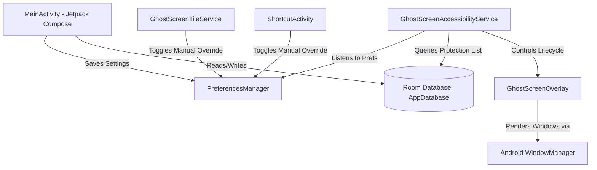

# Project Overview: GhostScreen

[GhostScreen](file:///d:/ghostscreen) is a specialized privacy utility app for Android designed to prevent "shoulder surfing" (unauthorized viewing of a user's screen in public spaces). By leveraging the Android Accessibility Service API, it overlays a custom, adjustable, semi-transparent mask with a clear, movable viewing window (cutout) over the screen. This allows the user to read and interact with their device through the viewport while keeping the rest of the screen obscured from side-viewers.

---

## 1. Main Purpose
The main purpose of GhostScreen is to protect user privacy in public settings (such as public transit, cafes, or offices) by shielding sensitive information—such as banking details, personal chat messages, or corporate credentials—from onlookers.

---

## 2. Main Features
- **Master Protection Arming**: A central toggle on the home screen to activate or deactivate the background monitoring service.
- **Dual Masking Modes**:
  - **SPLIT Mode (Default)**: Draws top and bottom horizontal masking bars, leaving a full-width horizontal clear strip that can be resized and moved vertically.
  - **BOX Mode**: Draws a rectangular, clear viewing window that can be freely resized (using four corner handles) and moved anywhere on the screen, while the rest of the screen is completely masked.
- **True Touch Passthrough**: In BOX mode, touches inside the clear viewing window pass directly through to the underlying applications, while only the corner handles and controllers intercept touches.
- **Smart Masking (Auto-App Detection)**: Users can select specific apps (e.g., WhatsApp, Gboard, banking apps, System UI) from a list. When the master switch is armed and one of these apps is opened, the overlay appears automatically.
- **Transient Surface Protection**: The overlay prevents flickering by maintaining the mask when the user pulls down the notification shade (System UI) or opens the keyboard (IME) while in a protected app.
- **Manual Override**: Allows the user to toggle the privacy mask on-demand via a launcher shortcut or Quick Settings Tile, ignoring automatic app-filtering rules.
- **Intruder Audit Logging**: Records interception events, documenting the package name, app name, and timestamp of every protected app access.
- **Frosted Glass (Blur) Effect**: In addition to solid color masks, users can configure a hardware-accelerated blur overlay with custom noise rendering.
- **Dynamic Launcher Icon**: Support for dynamic launcher theme customization (changing app icons dynamically via package aliases).

---

## 3. User Journey
1. **Onboarding**: On first launch, the user goes through an onboarding flow explaining the utility and requesting two essential system permissions:
   - **System Alert Window** (Display over other apps)
   - **Accessibility Service**
2. **Configuration**: The user opens the app to configure the privacy mask (color, transparency, or blur mode) and selects which apps are protected under "Smart Mask".
3. **Arming**: The user arms the protection via the central toggle on the home screen.
4. **Passive Protection**: The user goes about their normal phone usage. When they launch a protected app (like WhatsApp), the mask immediately slides in.
5. **Adjustment**: The user can drag the mask viewport (the "eye" controllers in Split mode or corner handles in Box mode) to align it with their reading area, or adjust mask transparency on the fly.
6. **Dismissal**: When exiting the protected app, the mask automatically hides. The user can also dismiss it manually at any time by tapping the floating close (X) button.

---

## 4. High-Level Architecture
GhostScreen is built as a native Android app in Kotlin. It separates the presentation (Jetpack Compose UI) from the background execution (Accessibility Service & Window Manager overlay).



---

## 5. Technology Stack & Dependencies
- **Programming Language**: Kotlin 2.0.21
- **UI Framework**: Jetpack Compose (using Material 3 and Compose Navigation)
- **Minimum SDK**: API 26 (Android 8.0)
- **Target SDK**: API 35 (Android 15)
- **Database**: Room Persistence Library 2.6.1 (SQLite wrapper)
- **Encryption**: Jetpack Security Crypto 1.1.0-alpha06 (for AES256-GCM encrypted preferences)
- **Asynchronous Execution**: Kotlin Coroutines & Flow

---

## 6. Folder Structure Explanation

```
d:/ghostscreen/
├── app/
│   ├── build.gradle.kts                # Module level Gradle configuration
│   └── src/
│       ├── androidTest/                # Android instrumentation tests
│       ├── test/                       # Unit tests
│       └── main/
│           ├── AndroidManifest.xml     # Application manifest
│           ├── java/com/etaegord/ghostscreen/
│           │   ├── data/               # Room Database schemas, DAOs, & PreferencesManager
│           │   ├── service/            # Accessibility, Tile, and Boot Receiver services
│           │   ├── ui/                 # MainActivity, ShortcutActivity, & Compose themes/screens
│           │   └── util/               # Transition engines, mathematical curves, & helpers
│           └── res/
│               ├── values/             # App strings, themes, and colors
│               └── xml/                # Accessibility service & shortcut configurations
├── build.gradle.kts                    # Root level Gradle build script
├── settings.gradle.kts                 # Project settings and module registry
├── structuredatabase.md                # Schema definitions of preferences and database tables
└── implementation_plan.md              # Log of identified bugs and their resolution plans
```

---

## 7. Code Quality & Project Status

### Overall Quality Score: 8.5 / 10
- **Strengths**: High-performance overlay drawing using raw Android views, decoupling layout optimizations from Compose's recomposition cycles. Decoupled, unit-testable window transition logic. Solid Material 3 design and dynamic theme compatibility. Asynchronous database reads.
- **Weaknesses**: Potential state synchronization race conditions in preferences loading (Tink initialization lag). Lack of orientation-change listeners in the custom window manager overlay. Nested untracked coroutine scopes in the Accessibility Service window state change handler.

### Current Development Stage
- **Production-Ready Core**: The fundamental privacy masking overlay engine and accessibility detection loops are fully operational, performant, and stable.
- **Refinement Phase**: Recent updates have focused on reducing jank (caching drawable-to-bitmap conversions inCompose LazyColumns) and resolving system-level UI/keyboard rendering synchronization (transient surface masking rules).

---

## 8. Missing Pieces & Future Features
- **Settings Sync Guard**: A mechanism to queue and flush settings updates during the Tink encryption initialization window to prevent startup configuration desyncs.
- **Screen Rotation Adaptive Layout**: Real-time layout recalculations inside [GhostScreenOverlay](file:///d:/ghostscreen/app/src/main/java/com/etaegord/ghostscreen/service/GhostScreenOverlay.kt) when screen orientation changes.
- **Quick Settings Tile Customization**: The ability to customize the Quick Settings Tile label and icon from the Settings screen.
- **Enhanced Testing**: Instrument tests verifying overlay Passthrough regions and multi-window behavior under simulation.
