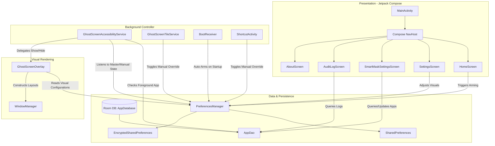
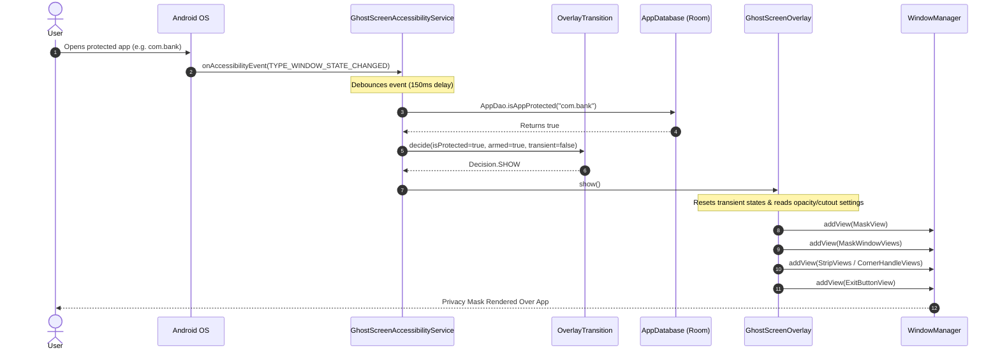

# Architectural Design: GhostScreen

This document describes the design architecture, component roles, state management, and structural data flows of the [GhostScreen](file:///d:/ghostscreen) application.

> [!NOTE]
> **Technical Stack Clarification**: Although the project parameters refer to Flutter integration, GhostScreen is a **100% native Android application** written in Kotlin. It does not contain any Dart, Flutter engine, or platform channel code.

---

## 1. High-Level Architectural Pattern

GhostScreen implements a custom architecture tailored for background utility services:
- **Presentation Layer**: Built with **Jetpack Compose** and **Material 3**. It operates as a single-activity architecture ([MainActivity](file:///d:/ghostscreen/app/src/main/java/com/etaegord/ghostscreen/ui/MainActivity.kt)).
- **Controller/Core Layer**: Composed of [GhostScreenAccessibilityService](file:///d:/ghostscreen/app/src/main/java/com/etaegord/ghostscreen/service/GhostScreenAccessibilityService.kt) (events interceptor) and [GhostScreenOverlay](file:///d:/ghostscreen/app/src/main/java/com/etaegord/ghostscreen/service/GhostScreenOverlay.kt) (window layout coordinator).
- **Utility/Domain Layer**: Houses pure, business-logic-only engines such as [OverlayTransition](file:///d:/ghostscreen/app/src/main/java/com/etaegord/ghostscreen/util/OverlayTransition.kt) (state machines) and [OpacityCurve](file:///d:/ghostscreen/app/src/main/java/com/etaegord/ghostscreen/util/OpacityCurve.kt) (visual calculations) that are completely decoupled from the Android framework, enabling pure JUnit testing.
- **Data Layer**: Powered by a local SQLite instance managed via **Room** ([AppDatabase](file:///d:/ghostscreen/app/src/main/java/com/etaegord/ghostscreen/data/AppDatabase.kt)) for persistence of protected app settings and logs, combined with [PreferencesManager](file:///d:/ghostscreen/app/src/main/java/com/etaegord/ghostscreen/data/PreferencesManager.kt) for quick configuration.

---

## 2. Core Architectural Diagram

The system's block components and their interaction pathways are illustrated below:

---

## 3. Component Interaction & Sequence Flow

When the user enters a protected app (e.g., a banking app), the sequence of events flows as follows:

---

## 4. Layer Separation & State Management

### 4.1 State Management
GhostScreen implements a decoupled, event-driven state model. Instead of relying on a centralized framework (such as BLoC or Riverpod), it utilizes:
1. **Compose State**: Native `mutableStateOf` and `collectAsState` are used inside the UI layer to maintain local reactivity (e.g., permission checks, loading states, lists of applications, and local log caches).
2. **Persistent State Listener**: The [PreferencesManager](file:///d:/ghostscreen/app/src/main/java/com/etaegord/ghostscreen/data/PreferencesManager.kt) serves as the broker for application states. When the state changes (such as toggling `isArmed` or `isManualOverrideActive`), it triggers a `registerOnSharedPreferenceChangeListener` listener in [GhostScreenAccessibilityService](file:///d:/ghostscreen/app/src/main/java/com/etaegord/ghostscreen/service/GhostScreenAccessibilityService.kt#L33-L59), prompting the service to recalculate the visibility of the overlay.
3. **Pure Logic Extraction**: The state machine driving the overlay transitions is extracted into the [OverlayTransition](file:///d:/ghostscreen/app/src/main/java/com/etaegord/ghostscreen/util/OverlayTransition.kt) object. The service passes context values (`currentPackage`, `isTransient`, `isProtected`, `lastEffectiveProtected`, `armed`, `manualOverride`) to `decide(...)` and executes the returned `Decision` enum (`SHOW`, `HIDE`, or `STAY`).

### 4.2 Data Flow
- **Writes**: Any configuration adjustments made in [SettingsScreen](file:///d:/ghostscreen/app/src/main/java/com/etaegord/ghostscreen/ui/screens/SettingsScreen.kt) or viewport adjustments made on the overlay are written back to [PreferencesManager](file:///d:/ghostscreen/app/src/main/java/com/etaegord/ghostscreen/data/PreferencesManager.kt). Writes occur instantly on the UI thread to `plainPrefs` and concurrently update the lazy `encryptedPrefs` in the background.
- **Reads**: Jetpack Compose screens read configuration parameters upon recomposition. The background service reads state updates reactively via preference change listeners.

---

## 5. Architectural Strengths & Weaknesses

### 5.1 Strengths
- **Low Recomposition Overhead**: The [HomeScreen](file:///d:/ghostscreen/app/src/main/java/com/etaegord/ghostscreen/ui/screens/HomeScreen.kt#L87-L105) animations are powered by a single coordinator (`InfiniteTransition`) and offloaded to the GPU using `graphicsLayer` modifiers. This prevents constant recompositions while the app is idle.
- **Pure Unit Testing Capability**: Decoupling the decision machine ([OverlayTransition](file:///d:/ghostscreen/app/src/main/java/com/etaegord/ghostscreen/util/OverlayTransition.kt)) and scale mapping ([OpacityCurve](file:///d:/ghostscreen/app/src/main/java/com/etaegord/ghostscreen/util/OpacityCurve.kt)) from the Android framework allows them to be validated quickly with standard JVM JUnit tests.
- **Optimized Overlay Rendering**: In BOX mode, the center viewing window does not draw a transparent overlay. Instead, it places four tiny windows at the corners and a central button at the bottom. This prevents the overlay from blocking touch events, ensuring touch passthrough works correctly on all Android versions.

### 5.2 Weaknesses & Architectural Smells
- **Preferences Startup Desync**: The lazy initialization of `EncryptedSharedPreferences` on a background thread creates a race condition. If a user modifies settings immediately after launching the app, changes are written to the unencrypted store but not the encrypted store. When the encrypted store finishes initializing, it overrides the getter, causing the app to read stale values.
- **Untracked Nested Coroutines**: When the accessibility service intercepts a window state change, it launches a coroutine on `serviceScope`. Within it, a database query is launched in another coroutine using `Dispatchers.IO`. The inner coroutine is not tracked or cancelled if the user quickly switches applications. This can cause database query completions to arrive out of order, creating a race condition that might show or hide the overlay incorrectly.
- **Missing Orientation Listeners**: The [GhostScreenOverlay](file:///d:/ghostscreen/app/src/main/java/com/etaegord/ghostscreen/service/GhostScreenOverlay.kt) computes physical screen bounds once upon showing. If the device rotates, the overlay does not recalculate its dimensions or update window parameters, causing the mask to become misaligned.
