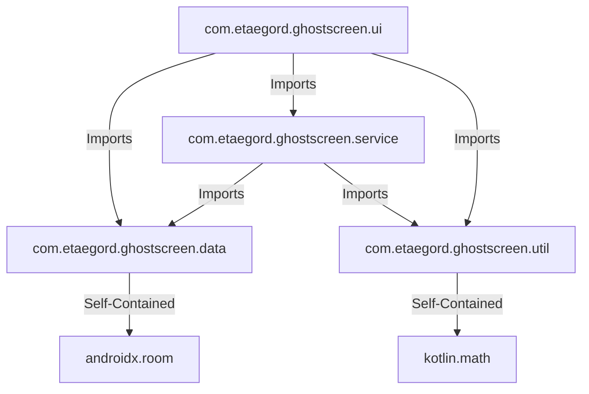
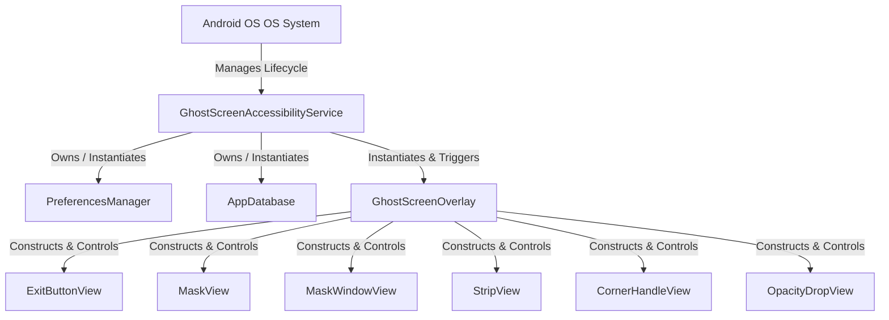
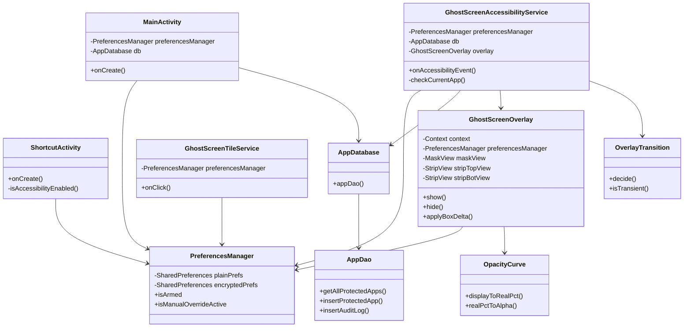
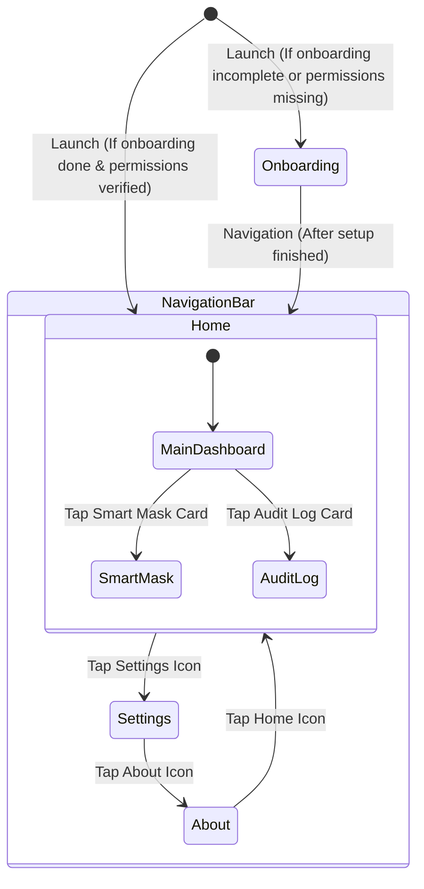
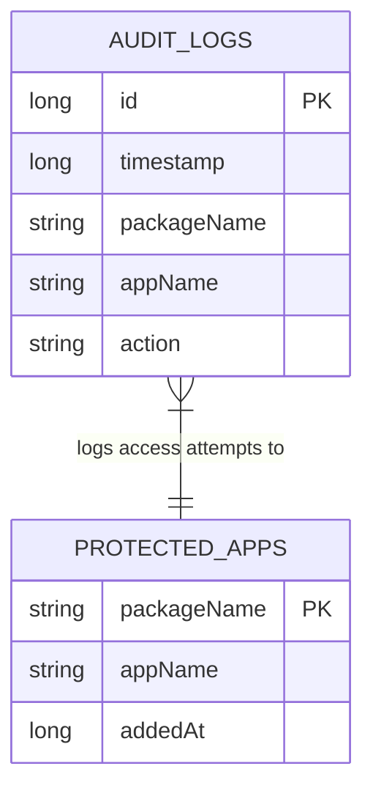

# System Dependency Graph: GhostScreen

This document maps the package dependencies, ownership hierarchies, navigation flows, and database interactions within the [GhostScreen](file:///d:/ghostscreen) application.

---

## 1. Package Graph (Architecture Decoupling)

This graph displays the structural relationships between packages. The arrows indicate outgoing imports (efferent coupling).

### Coupling Instability Metrics
The instability metric ($I = C_e / (C_a + C_e)$) measures package susceptibility to change:

- **`data` Package**: $C_e = 0$, $C_a = 2 \rightarrow$ **Instability $I = 0.0$** (Highly Stable). Changes in data logic propagate upward; changes in other packages do not affect it.
- **`util` Package**: $C_e = 0$, $C_a = 2 \rightarrow$ **Instability $I = 0.0$** (Highly Stable). Pure mathematical and transition engines.
- **`service` Package**: $C_e = 2$, $C_a = 1 \rightarrow$ **Instability $I = 0.67$** (Moderately Stable). Coordinates system integrations.
- **`ui` Package**: $C_e = 3$, $C_a = 0 \rightarrow$ **Instability $I = 1.0$** (Highly Unstable). Presentation layer that absorbs changes from all other modules.

---

## 2. Core Service Ownership & View Hierarchy

This graph details object ownership and lifetime containment within the background execution pipeline.

---

## 3. Class-Level Structural Dependency Diagram

The complete class-to-class interaction graph illustrates imports and composition relationships:

---

## 4. Compose Navigation & UI Flow

This graph illustrates user navigation transitions across views inside [MainActivity](file:///d:/ghostscreen/app/src/main/java/com/etaegord/ghostscreen/ui/MainActivity.kt).

---

## 5. Database Interaction Topography

The tables, fields, and operations defined within the [AppDatabase](file:///d:/ghostscreen/app/src/main/java/com/etaegord/ghostscreen/data/AppDatabase.kt) schema:

