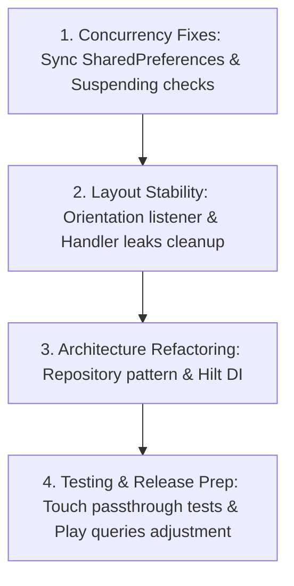

# Architectural Audit Report: GhostScreen

**Author**: Staff Software Architect  
**Project**: GhostScreen Android Privacy Utility  
**Date**: 2026-07-04  
**Target Release**: Production Ready (v5.0-Release Candidate)  

---

## 1. Executive Summary & Grading

This audit evaluates the [GhostScreen](file:///d:/ghostscreen) native Android codebase prior to production release. The app implements a system-level overlay using Android Accessibility APIs to prevent "shoulder surfing".

While the overlay rendering engine itself is highly performant and handles passthrough events efficiently, the application's core architecture suffers from synchronization defects, concurrency race conditions, and lack of component decoupling.

### Quality Metrics & Scoring

| Category | Score | Status | Key Findings |
|---|---|---|---|
| **Architecture** | **65 / 100** | Needs Attention | tight coupling, direct DB/Dao access in services, lack of Dependency Injection (DI) framework |
| **Code Quality** | **75 / 100** | Good | clean and structured Kotlin, strong adherence to Compose formatting guidelines |
| **Maintainability** | **70 / 100** | Acceptable | hardcoded dependencies, lack of repository pattern |
| **Scalability** | **60 / 100** | Needs Attention | scaling to multiple preference keys or databases will introduce boilerplate |
| **Performance** | **75 / 100** | Good | rendering optimizations in overlay; minor Compose recomposition issues |
| **Security** | **70 / 100** | Good | EncryptedSharedPreferences used, but initialization state desync poses a risk |
| **Readability** | **85 / 100** | Very Good | expressive names, clear layout divisions, helpful developer comments |
| **Testing** | **20 / 100** | Critical | complete absence of integration, UI, and touch passthrough tests |
| **Developer Experience** | **65 / 100** | Needs Attention | project root clutter (`rewrite.kt`, `temp.txt`), manual initialization boilerplate |
| **Production Readiness**| **50 / 100** | Unacceptable | blocked by critical startup race conditions and rotation rendering issues |

**Overall Weighted Score: 61.5 / 100**  
> [!WARNING]
> **Production Gate Status: BLOCKED**. The application cannot be released to production until the **Critical** and **High** issues identified in Section 2 are resolved.

---

## 2. Detailed Audit Log

### 2.1 Critical Severity Issues

#### Issue 1: Preferences Initialization State Desync
* **Evidence**: [PreferencesManager.kt](file:///d:/ghostscreen/app/src/main/java/com/etaegord/ghostscreen/data/PreferencesManager.kt) initializes `EncryptedSharedPreferences` lazily on a background coroutine inside the constructor:
  ```kotlin
  CoroutineScope(Dispatchers.IO + SupervisorJob()).launch {
      val ePrefs = EncryptedSharedPreferences.create(...)
      // ...
      encryptedPrefs = ePrefs
  }
  ```
  Writes go to both preferences, but only if the encrypted instance is non-null:
  ```kotlin
  private fun edit(block: SharedPreferences.Editor.() -> Unit) {
      plainPrefs.edit().apply { block() }.apply()
      encryptedPrefs?.edit()?.apply { block() }?.apply() // Null-safe check skips write if null
  }
  ```
* **Why It Is Wrong**: The Tink crypto engine verification can take 3–9 seconds to initialize on startup. During this window, `encryptedPrefs` remains null. If the user changes configurations (such as toggling protection status or changing colors) during this period, the values are written *only* to `plainPrefs`. Once initialization completes, the `prefs` getter redirects all reads to `encryptedPrefs`, which still holds the stale value from the previous launch.
* **Production Impact**: Settings changed immediately after app start are silently dropped and reverted 3–9 seconds later. This leads to a buggy and inconsistent user experience.
* **Industry Best Practice**: Avoid concurrent dual-write engines with asymmetric initialization. Use standard Jetpack Preferences DataStore with custom security adapters, or block access until initialization is complete using transactional queues.
* **Recommended Fix**: Implement an in-memory queue. Any configuration changes made before initialization must be cached and flushed to `EncryptedSharedPreferences` once it becomes active.
* **Implementation Difficulty**: Medium.
* **Potential Risks**: Low (requires unit tests to verify preference synchronization).

---

### 2.2 High Severity Issues

#### Issue 2: Accessibility Event Interception Race Condition
* **Evidence**: [GhostScreenAccessibilityService.kt](file:///d:/ghostscreen/app/src/main/java/com/etaegord/ghostscreen/service/GhostScreenAccessibilityService.kt#L113-L184) calls `checkCurrentApp` which launches a new coroutine on `serviceScope`:
  ```kotlin
  private fun checkCurrentApp(packageName: String) {
      serviceScope.launch {
          val shouldProtect = withContext(Dispatchers.IO) {
              db.appDao().isAppProtected(effectivePackage)
          }
          // ... decision updates
      }
  }
  ```
* **Why It Is Wrong**: When a user switches apps, `pendingCheckJob?.cancel()` is called to debounce the execution. However, once `checkCurrentApp` is called, it launches a nested coroutine on `serviceScope` that is *not* tracked by `pendingCheckJob`. If the database query on `Dispatchers.IO` is slow, multiple query coroutines run concurrently. Their completion order is not guaranteed, allowing older events to resolve after newer ones.
* **Production Impact**: The privacy mask may hide itself when entering a protected app, or display itself when entering an unprotected app.
* **Industry Best Practice**: Maintain a single source of truth for async tasks and cancel previous executions when a new state event arrives.
* **Recommended Fix**: Make `checkCurrentApp` a suspending function. Call it within the parent `pendingCheckJob` so it is properly cancelled when a new event arrives:
  ```kotlin
  pendingCheckJob = serviceScope.launch {
      delay(150)
      checkCurrentAppSuspend(packageName) // Properly cancelled on reschedule
  }
  ```
* **Implementation Difficulty**: Medium.
* **Potential Risks**: Low.

---

### 2.3 Medium Severity Issues

#### Issue 3: Screen Rotation Overlay Layout Disruption
* **Evidence**: `screenW` and `screenH` in [GhostScreenOverlay.kt](file:///d:/ghostscreen/app/src/main/java/com/etaegord/ghostscreen/service/GhostScreenOverlay.kt#L205-L214) are computed once in `show()` and never updated.
* **Why It Is Wrong**: The dimensions of mask windows and controller views are calculated using these cached values. When the device rotates, these coordinates remain unchanged, leaving the overlay misaligned.
* **Production Impact**: Mask is misaligned, too small, or offscreen after rotation, exposing private information.
* **Industry Best Practice**: Register listeners to adapt layout elements when configuration changes occur.
* **Recommended Fix**: Register a `ComponentCallbacks` listener inside the accessibility service to detect screen rotations, update dimensions, and trigger layout updates.
* **Implementation Difficulty**: Medium.
* **Potential Risks**: Low.

#### Issue 4: Memory and Handler Leaks in View Runnables
* **Evidence**: [GhostScreenOverlay.kt](file:///d:/ghostscreen/app/src/main/java/com/etaegord/ghostscreen/service/GhostScreenOverlay.kt) postDelayed runnables (`idleRun`, `hideLbl`, `longRun` in `StripView` and `OpacityDropView`) are not cleared when views are removed from the window manager.
* **Why It Is Wrong**: The views are removed, but `mainHandler` still holds references to these view runnables, leaking the views and the outer [GhostScreenOverlay](file:///d:/ghostscreen/app/src/main/java/com/etaegord/ghostscreen/service/GhostScreenOverlay.kt) instance (which holds the service Context).
* **Production Impact**: Memory accumulation over long device sessions; potential crashes if these runnables execute after views are detached.
* **Recommended Solution**: Implement an explicit cleanup method in both views (or override `onDetachedFromWindow()`) to cancel all pending handler messages.
* **Implementation Difficulty**: Low.
* **Potential Risks**: Very low.

#### Issue 5: Play Store Publishing Compliance Risk
* **Evidence**: [AndroidManifest.xml](file:///d:/ghostscreen/app/src/main/AndroidManifest.xml#L6) requests the broad `QUERY_ALL_PACKAGES` permission.
* **Why It Is Wrong**: Google Play policies restrict this permission to specific app types (e.g., file managers, antivirus software).
* **Production Impact**: The app will be rejected from Google Play publishing.
* **Recommended Solution**: Remove the permission and declare targeted `<queries>` blocks for popular apps, or let the user add apps manually using a custom package name input.
* **Implementation Difficulty**: Medium.
* **Potential Risks**: None.

#### Issue 6: Complete Absence of Integration and UI Tests
* **Evidence**: Only basic unit tests exist in `test/` (2 files). No instrumented tests in `androidTest/` exist that verify overlay passthrough regions or window state change flows.
* **Why It Is Wrong**: Crucial interactions (accessibility events, overlay passthrough, touch interception) are untested.
* **Production Impact**: Changes in layout code can easily break touch passthrough zones, resulting in unusable overlays that intercept all touches, causing system-wide user lockouts.
* **Recommended Fix**: Set up UI tests using Espresso or UI Automator to simulate window state changes and check overlay touch boundaries.
* **Implementation Difficulty**: High.
* **Potential Risks**: None.

---

### 2.4 Low Severity Issues

#### Issue 7: Direct Database Access from Service (Layer Violation)
* **Evidence**: [GhostScreenAccessibilityService.kt](file:///d:/ghostscreen/app/src/main/java/com/etaegord/ghostscreen/service/GhostScreenAccessibilityService.kt#L122) queries the database directly.
* **Why It Is Wrong**: Violates Clean Architecture layer separation. A Service should delegate domain logic and data access to a Repository layer.
* **Recommended Fix**: Introduce a repository abstraction to manage database access and background thread dispatching.
* **Implementation Difficulty**: Low.
* **Potential Risks**: Very low.

#### Issue 8: Lack of Dependency Injection
* **Evidence**: Constructors are manually instantiated (e.g., `PreferencesManager(applicationContext)`).
* **Why It Is Wrong**: Hardcoded instantiation violates Dependency Inversion, making components tightly coupled and hard to mock for testing.
* **Recommended Fix**: Integrate Hilt or Koin to inject database, DAO, and preference instances.
* **Implementation Difficulty**: Medium.
* **Potential Risks**: Low.

---

## 3. Production Readiness Roadmap

To ensure a safe release, resolve these issues in the following order:



### Phase 1: Core Concurrency & Concurrency Fixes (Immediate)
1. Refactor [PreferencesManager.kt](file:///d:/ghostscreen/app/src/main/java/com/etaegord/ghostscreen/data/PreferencesManager.kt) to queue settings changes during the initialization window.
2. Refactor `checkCurrentApp` in [GhostScreenAccessibilityService.kt](file:///d:/ghostscreen/app/src/main/java/com/etaegord/ghostscreen/service/GhostScreenAccessibilityService.kt) to use a suspending function, ensuring active checks are cancelled when a new window state event is received.
3. Validate these fixes using the existing unit test suite:
   ```bash
   ./gradlew testDebugUnitTest
   ```

### Phase 2: Layout Stability & Memory Leak Fixes (Short-Term)
1. Add an orientation change listener to [GhostScreenAccessibilityService.kt](file:///d:/ghostscreen/app/src/main/java/com/etaegord/ghostscreen/service/GhostScreenAccessibilityService.kt) to update dimensions in [GhostScreenOverlay.kt](file:///d:/ghostscreen/app/src/main/java/com/etaegord/ghostscreen/service/GhostScreenOverlay.kt).
2. Override `onDetachedFromWindow()` in the custom overlay views to cancel all pending handler messages.

### Phase 3: Architectural Cleanup (Mid-Term)
1. Introduce a repository abstraction to manage database access and background thread dispatching.
2. Integrate a dependency injection framework (such as Hilt) to inject database, DAO, and preference instances.

### Phase 4: Release Compliance & Verification (Pre-Release)
1. Remove `QUERY_ALL_PACKAGES` from the manifest and configure targeted `<queries>` elements instead.
2. Write instrumentation tests to verify overlay passthrough regions and touch boundaries.
3. Build the final production release candidate APK:
   ```bash
   ./gradlew assembleRelease
   ```
